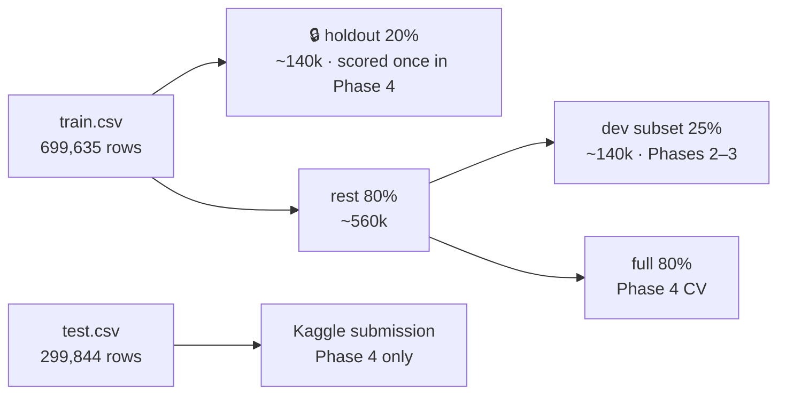

# Plan 01: Feature Engineering & Modeling Pipeline

| | |
|---|---|
| **Status** | Approved · in progress |
| **Revised** | 2026-10-17 |
| **Competition** | [playground-series-s6e10](https://www.kaggle.com/competitions/playground-series-s6e10/overview), Predicting Airline Satisfaction |
| **Metric** | ROC AUC on predicted probabilities |
| **Deadline** | 2026-10-31 |
| **Working notebook** | `notebooks/bruce_v1.py` |

---

## 1. WHY (Objective)

**Problem.** Predict whether a passenger is satisfied (`satisfaction`, 44.4% positive) from
21 features: demographics, trip details, 13 service ratings (0–5) and delays.

**Goals**
1. **Learn what matters.** Find out which feature engineering moves the needle, while
   keeping the model simple and fixed (logistic regression), so every gain can be
   explained.
2. **Build once, reuse.** End up with an end-to-end pipeline (raw CSV → CV score →
   submission) whose code lives in `src/` and can be cloned for the next competition.
3. **Spend the test set sparingly.** Kaggle's test set is the final exam, not a tuning tool.

**Principles**
- **Change one thing at a time.** First features (model fixed), then the model (features
  fixed), then the full data.
- **Small data first.** Iterate on a subset so each loop takes seconds, not minutes.
- **Keep a private holdout.** Set aside a slice of `train` that's never used while
  iterating. It stands in for the test set.
- **Notebook first, then promote.** Prototype a step in `bruce_v1.py`. Once it works on
  real data, move it into `src/` with a test, and the cell becomes a one-line call.

**Success looks like**
- A leaderboard showing which feature ideas helped, and by how much.
- A validated submission CSV from the final pipeline, submitted by 2026-10-31.
- `pixi run test` passes.

---

## 2. WHAT (Requirements)

Tick a box when the item is done **and** its check has actually run.

### Phase 0 · Setup
- [x] Use `notebooks/bruce_v1.py` as the pipeline notebook
- [x] Extend `normalize_columns()` with reusable naming styles (`simple`, `snake_case`),
      overrides, collision checks and a CLI → `src/datahelpers/datawrangle.py`
- [x] Track `reports/experiments/leaderboard.csv` in git (`.gitignore` exception)
- [x] `pixi run test` task, plus tests for column naming
- [x] Test inputs are declarative YAML (`tests/cases/*.yaml`); test scripts are generic runners
- [x] Add `pyyaml` to `pixi.toml` explicitly (manifest + lockfile updated)
- [x] Draft config YAMLs for review: `configs/competition.yaml` + one file per
      iteration step in `configs/experiments/` (k-fold CV with `n_splits: 4`)
- [x] Salted-hash randomization for holdout, dev subset and folds (`randomization.salt`
      in `competition.yaml`) → `src/datahelpers/splits.py` + YAML test cases
- [ ] Review and approve the config drafts

### Phase 1 · Data and splits
- [ ] Load train, test and sample submission with DuckDB, and snake_case the columns
- [ ] Split off a fixed **holdout** (20% of train, stratified, salted hash) and save its ids
- [ ] Draw a fixed **dev subset** (25% of the rest, stratified) for fast iteration
- [ ] Sanity check: row counts, target rate in each split, nulls

### Phase 2 · Feature engineering (model fixed, dev subset)
- [ ] `lr_00` baseline: impute + scale numerics, ratings as numbers, one-hot categoricals
- [ ] `lr_01` ratings as one-hot categories
- [ ] `lr_02` ratings as numbers + `is0` / `ge4` flags (alternative to 01)
- [ ] `lr_03` delays: missing flag, `log1p`, delay difference
- [ ] `lr_04` splines on age and flight distance
- [ ] `lr_05` crosses: class × type of travel, class × customer type
- [ ] `lr_06` rating aggregates (mean, min, max, counts, group means; zeros excluded)
- [ ] `lr_07` crosses: type of travel × {wifi, online boarding}
- [ ] Review the leaderboard together and pick the winning feature set

### Phase 3 · Model iteration (features fixed, dev subset)
- [ ] Regularization grid: `C ∈ {0.01, 0.1, 1, 10}` × `l1_ratio ∈ {0, 0.5}`
- [ ] Diagnostics: ROC, calibration, top coefficients, AUC by segment
- [ ] Pick the final model settings

### Phase 4 · Full data and ship
- [ ] Re-run the winner with CV on the full training data (holdout still excluded)
- [ ] Score the holdout **once** and compare it with CV
- [ ] Refit on all labelled data, predict test, and validate the submission file
- [ ] Submit to Kaggle (manual, after your go-ahead) and record the public LB score

### Reusable code (promoted from the notebook as each phase completes)
- [ ] `src/utils`: project root, YAML config loading (`extends`), logging
- [ ] `src/datahelpers`: data loader, `prepare_frames`, holdout and dev splits
- [ ] `src/features`: registry of feature blocks + pipeline builder
- [ ] `src/modeling`: model registry, metrics, CV with OOF, experiment runner, diagnostics
- [ ] `src/submission.py`: build and validate a submission
- [ ] `alfred.py` CLI: `cv`, `train`, `leaderboard`, `submit` (submit asks y/N)
- [ ] Tests: config merging, features (no leakage, same columns on train and test),
      CV (folds are reproducible), submission validation

### Out of scope (for now)
Tree and boosting models, target encoding, Optuna, blending or stacking, MLflow, and
adding the original 129k dataset. The design leaves room for each.

---

## 3. HOW (Execution)

### 3.1 Data splits



- **Randomization is a salted hash, not a random seed.** Each row gets
  `BLAKE2b("<salt>/<purpose>:<id>")`, with purpose = holdout, dev or cv. Rows are ranked by
  that hash within each target class, which gives exact stratification. The same salt
  gives identical splits whatever the row order; a new salt reshuffles everything. The salt
  lives in `randomization.salt` in `competition.yaml`. `seed` is only the model's
  `random_state`.
- Every iteration step uses stratified **k-fold CV, k = 4** (`cv.n_splits`; an experiment
  can override it). **Same salt means same folds** for every experiment, so scores are
  comparable.
- Check it with `pixi run python -m src.datahelpers.splits summary configs/competition.yaml`
  (optionally `--salt <new>`).
- The final model is refit on all 699,635 labelled rows before predicting test.

### 3.2 Notebook-first workflow

For each step: prototype a cell in `bruce_v1.py`, check it on real data, then move the
code into `src/` with a test and replace the cell with a call to it. The notebook stays a
short storytelling document (slides: problem → data → features → CV → diagnostics →
leaderboard → submission). Expensive cells sit behind `mo.ui.run_button`.

### 3.3 Configuration

Each experiment is a YAML file that `extends` its parent and only states what changed.
Dicts merge, lists replace, and the child wins. `derive` blocks and `encode` groups are
**keyed by name**, so a child can add one block or override one group without restating
the rest. The fully merged config is saved with each run.

```
competition.yaml            shared: data, schema, splits, cv (k=4), keep rule
└─ lr_00_baseline           Phase 2: features (model fixed, dev subset)
   ├─ lr_01_ratings_onehot
   │  └─ lr_03_delays        (extends the 01/02 winner)
   │     └─ lr_04_splines → lr_05_crosses → lr_06_rating_aggregates → lr_07_rating_crosses
   │                           └─ lr_08_regularization   Phase 3: model grid (dev subset)
   │                              └─ lr_final_full       Phase 4: full data + holdout + submit
   └─ lr_02_rating_flags
```

```yaml
# configs/experiments/lr_04_splines.yaml: only the continuous group changes
name: lr_04_splines
extends: lr_03_delays.yaml
encode:
  continuous:
    steps:
      - impute: {strategy: median}
      - log1p:  {cols: [departure_delay_in_minutes, arrival_delay_in_minutes]}
      - spline: {cols: [age, flight_distance], n_knots: 6, degree: 3}
      - scale:  {method: standard}
```

`configs/competition.yaml` holds what's competition-specific: data paths, id and target
columns, metric, salt and seed, column naming (`snake_case`) and the column schema (continuous,
ordinal, categorical), rating groups, splits, CV settings and the keep rule. It's the
only file you rewrite for a new competition. `tests/test_configs.py` checks that every
config parses, every `extends` target exists, the schema matches the real headers, and
every `@ref` resolves.

### 3.4 Features

Two kinds of feature blocks, kept apart on purpose:

| Kind | What it does | Leakage | Examples |
|---|---|---|---|
| **derive** | Stateless, row by row; adds columns | Can't leak (learns nothing) | `missing_flag`, `zero_flag`, `ge_flag`, `cross`, `delay_features`, `rating_aggregates` |
| **encode** | Learns from data (medians, scalers, knots, categories) | Fit inside each CV fold | `impute`, `log1p`, `clip`, `spline`, `scale`, `onehot` |

Blocks register themselves by name (`@register_derive("zero_flag")`), so a YAML file can
use them without any code changes. The builder turns a config into an sklearn
`Pipeline(derive → ColumnTransformer(encode) → model)` with pandas output, which keeps
feature names readable in the coefficient tables.

### 3.5 Feature ladder: evidence and keep rule

Each rung comes from an EDA observation (satisfaction rate on train):

| Rung | EDA evidence | Why a linear model needs help |
|---|---|---|
| 01 / 02 | Wifi 0→**89%**, 1→39%, 3→28%, 5→95%. Online boarding 0→62%, 3→13%, 4→64%. | Non-monotonic; 0 means N/A; step between 3 and 4 |
| 03 | Departure delay 0→44.8% vs >0→40%; heavy right skew; 292 nulls in arrival delay | Skew and missing values |
| 04 | Age is an inverted U (40s–50s ≈ 60%, 70s ≈ 10%). Distance jumps at ~1,500 mi (≈33% → 62%). | A straight line can't follow either |
| 05 | Business class + business travel 73%; business class + personal travel 11% | Interaction effect |
| 06 | 13 weak, correlated ratings | An overall-experience summary is easier for LR to use |

**Keep rule:** a rung stays if OOF AUC improves by **≥ 0.0005** and the gain is larger
than the fold standard deviation. Otherwise it's reverted. Rungs 01 and 02 compete; the
next rung builds on the winner (or on both, if they combine well).

### 3.6 Model

`LogisticRegression` with `C` and `l1_ratio`. In sklearn 1.9, `penalty` is deprecated:
use `l1_ratio=0` for L2, `0 < l1_ratio < 1` for elastic net (`solver="saga"`), and
`C=np.inf` for no penalty. Metrics logged: ROC AUC (primary), log loss, accuracy at 0.5.

### 3.7 Run artifacts

Each run writes `reports/experiments/<YYYYMMDD-HHMMSS>_<name>/` containing the resolved
config, `meta.json` (git commit, config hash, timings), fold scores, OOF and test
predictions (parquet, gitignored) and coefficients. It also appends one row to
`reports/experiments/leaderboard.csv` (tracked in git):
`run_id, name, data_subset, n_features, cv_mean, cv_std, oof_auc, oof_logloss, holdout_auc, fit_seconds, config_hash, git_commit, public_lb`.

### 3.8 Code layout

```
configs/competition.yaml, configs/experiments/*.yaml
src/utils/        paths · config · logging
src/datahelpers/  dataloader · datawrangle (normalize_columns, prepare_frames, splits)
src/features/     registry · derive · encode · domain · build
src/modeling/     models · metrics · validate · train · experiment · diagnostics
src/submission.py
alfred.py         typer CLI
tests/            synthetic-data tests (no private data)
```

Every module is importable from the notebook and runnable from the command line with
typer, for example `pixi run python -m src.datahelpers.datawrangle columns <csv>`.

### 3.9 Risks

| Risk | Mitigation |
|---|---|
| LR is slow with many one-hot and spline columns on 700k rows | Dev subset in Phases 2–3; sparse output with `saga` as a fallback; `fit_seconds` on the leaderboard |
| Overfitting CV by climbing many rungs | Fixed folds, a minimum-gain rule, and the holdout check in Phase 4 |
| Config typos fail silently | Validate block names, params and column references up front |

### 3.10 Decisions log

| # | Decision |
|---|---|
| D1 | Configs are YAML; experiments `extends` a parent |
| D2 | Code is split by theme (`datahelpers`, `features`, `modeling`, `utils`); the whole repo is the reusable template |
| D3 | Tracking is a CSV leaderboard plus one folder per run (no MLflow); the leaderboard is in git |
| D4 | Known `eda.py` issues are left alone (unparsable sweetviz line; path needs a trailing slash) |
| D5 | `notebooks/bruce_v1.py` is the pipeline notebook; it's built notebook-first |
| D6 | `scratch*` files are ignored |
| D7 | Logistic regression only in this plan; the effort goes into features |
| D8 | Columns are renamed with `normalize_columns(df, style="snake_case")`; the default `simple` style keeps `eda.py` unchanged |
| D9 | Staged iteration: features on a dev subset → model on a dev subset → full data. A 20% holdout is scored once; Kaggle test is used only in Phase 4 |
| D10 | Splits and folds are assigned by a salted hash of `id` (salt configurable in YAML), not a random seed |
