# Plan 01: Reusable Feature Engineering & Modeling Pipeline

| | |
|---|---|
| **Status** | Detailed plan, waiting for approval. No code has been changed. |
| **Created / revised** | 2026-10-17 |
| **Competition** | [playground-series-s6e10](https://www.kaggle.com/competitions/playground-series-s6e10/overview), Predicting Airline Satisfaction |
| **Metric** | ROC AUC on predicted probabilities |
| **Deadline** | 2026-10-31 |

> 🖼️ **Diagrams.** This plan uses Mermaid. GitHub renders it natively. In VS Code, install
> the *Markdown Preview Mermaid Support* extension (`bierner.markdown-mermaid`) and open the
> preview with `⌘⇧V`.

## Plan at a glance

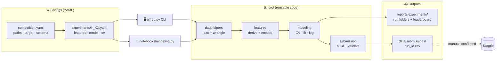

**How to read it:** you write YAML (left). The same `src/` code runs whether you start it
from the CLI or the notebook (middle). Every run leaves a scored record and a submission
file (right). Uploading to Kaggle is always a manual, confirmed step.

---

## 0. Decisions so far

| # | Decision | Source |
|---|---|---|
| D1 | Configs are **YAML** (matching `configs/log_config.yaml`). `pyyaml` 6.0.3 is already installed. | User |
| D2 | Code is **split by theme** (`datahelpers`, `features`, `modeling`, `utils`) so each unit is easy to read. The whole repo gets cloned for future projects, so there's no separate "portable kit". | User |
| D3 | Experiment tracking is a **plain CSV leaderboard plus one folder per run**. No MLflow. | User |
| D4 | Pre-existing notebook issues are **not fixed** as part of this work (§14). | User |
| D5 | Build a **fresh marimo notebook** (`notebooks/modeling.py`) so you can compare it with `notebooks/eda.py`. Don't edit existing notebooks. | User |
| D6 | Files named `scratch*` are ignored (AGENTS.md). Nothing in this plan reads, ports or depends on them. | User |
| D7 | Phase 1 model: **logistic regression only**. The effort goes into feature engineering. | User |

---

## 1. Goal and scope

**Goal.** One config-driven workflow, from raw Kaggle CSVs to validated OOF scores to a
submission CSV. Iterating means writing a new experiment YAML, not editing code.

**In scope (phase 1)**
- Loading data from config
- A library of reusable feature blocks
- An sklearn pipeline builder
- Stratified CV with OOF predictions
- Fitting on the full data and predicting test
- Writing and validating the submission
- Run artifacts and the leaderboard
- A typer CLI
- pytest tests
- A storytelling marimo notebook

**Out of scope for now:** tree or boosting models, target encoding, Optuna, blending or
stacking, MLflow. The design leaves room for each of these (§13).

**Definition of done for phase 1**
1. `pixi run train configs/experiments/lr_00_baseline.yaml` produces a CV score, a run
   folder, a leaderboard row and a validated submission CSV.
2. `pixi run test` passes.
3. `notebooks/modeling.py` tells the story end to end using only `src/` calls.
4. At least the first 4 rungs of the feature ladder (§9) are run and compared on the
   leaderboard.

---

## 2. Repo conventions I'll follow

| Convention | Where it comes from | How the plan follows it |
|---|---|---|
| Library code in `src/`, tests in `tests/`, notebooks in `notebooks/` | AGENTS.md | New modules go in `src/`; `tests/` is created |
| Run everything through `pixi run`; no system Python | AGENTS.md | New `[tasks]` in `pixi.toml`. **No new dependencies.** |
| Type annotations; computation separate from I/O; explicit inputs; `pathlib`; seeds exposed | python.md | Pure functions take DataFrames or configs. I/O is isolated in `*_io`-style functions. `seed` lives in config. |
| Scripts are both importable **and** CLI-callable with typer | python.md | Each module exposes plain functions. `alfred.py` is the typer entry point that composes them. |
| DuckDB > Polars > Pandas; Plotly first; sklearn | python.md | DuckDB for loading and summaries, pandas at the sklearn boundary, Plotly for every chart |
| Short notebook cells; heavy logic in `src/`; storytelling, slide/app mode | notebooks.md | The notebook calls at most 1–3 `src/` functions per cell, with markdown narrative between them |
| Module headers (`__author__`, `__email__`, shebang, docstring) | `alfred.py`, `dataloader.py` | New modules use the same header |
| Env vars `DIR_PROJECT`, `DIR_KAGGLE_REL` via `.env` | `notebooks/eda.py`, `.env.template` | Project root resolution uses `DIR_PROJECT` if set, otherwise walks up to `pixi.toml` |
| Logging via `configs/log_config.yaml` (logger `alfred`, files under `logs/`) | configs | Reuse it as is. `logs/` is created at startup if it's missing. |
| `*.csv` is gitignored | `.gitignore` | Submissions and OOF files never get committed. OOF/test predictions are saved as **parquet**, so I'll add `reports/experiments/**/*.parquet` to `.gitignore`. |

---

## 3. Data facts and EDA evidence behind the features

Checked with DuckDB on `train.csv`.

**Shape.** Train has 699,635 rows; test has 299,844. There are 22 features plus `id`, and
the target `satisfaction` is a boolean. Positive rate is **44.4%**: use stratified CV, no
resampling.

**Missing values.** Only `Arrival Delay in Minutes`: 292 nulls in train and 130 in test.

**Column groups**

| Group | Columns |
|---|---|
| Continuous (4) | `age`, `flight_distance`, `departure_delay_in_minutes`, `arrival_delay_in_minutes` |
| Ordinal ratings, 0–5 (14) | wifi, dep/arr time convenience, online booking, gate, food, online boarding, seat comfort, entertainment, on-board service, leg room, baggage (1–5 only), check-in, cleanliness |
| Categorical (4) | `gender`, `customer_type`, `type_of_travel`, `class` |

**Evidence that shapes the feature choices for a linear model**

| Observation (train satisfaction rate) | Implication for LR |
|---|---|
| **Wifi rating:** 0→**0.89**, 1→0.39, 2→0.27, 3→0.28, 4→0.62, 5→0.95 | Strongly **non-monotonic**, and 0 is *not* "worst". Use one-hot ratings or a zero flag plus a linear term. |
| **Online boarding:** 0→**0.62**, 1→0.11, 2→0.09, 3→0.13, 4→0.64, 5→0.88 | Same pattern: 0 means N/A, and there's a step between 3 and 4 |
| **Seat comfort / Entertainment:** 1–3 sit around 0.13–0.24, while 4–5 sit around 0.57–0.67 | **Threshold** effect. A "rating ≥ 4" indicator or one-hot captures it better than a slope. |
| **Class × Type of Travel:** Business+Business travel 0.73, Business+Personal **0.11**, Eco+Business 0.26, Eco+Personal 0.10 | Strong **interaction**. Business class only helps business travellers, so this needs a cross feature. |
| **Customer type:** loyal 0.50 vs disloyal 0.20 | Strong main effect; one-hot is enough |
| **Age (by decade):** 0s 0.09, 20s 0.32, 40s–50s **0.60**, 60s 0.27, 70s 0.10 | **Inverted U.** Needs splines or bins; a linear term misses it. |
| **Flight distance (per 500):** <1500 ≈ 0.29–0.34, then a **jump** to 0.62 at 1500–2000, rising to about 0.82 at 3500+ | **Threshold** plus monotone increase. Use splines or log plus bins. |
| **Departure delay:** 0 → 0.448 vs >0 → 0.40 | Weak but real. Heavy right skew, so use `log1p` plus a "delayed" flag. |

**The same evidence as charts** (satisfaction %, train set):

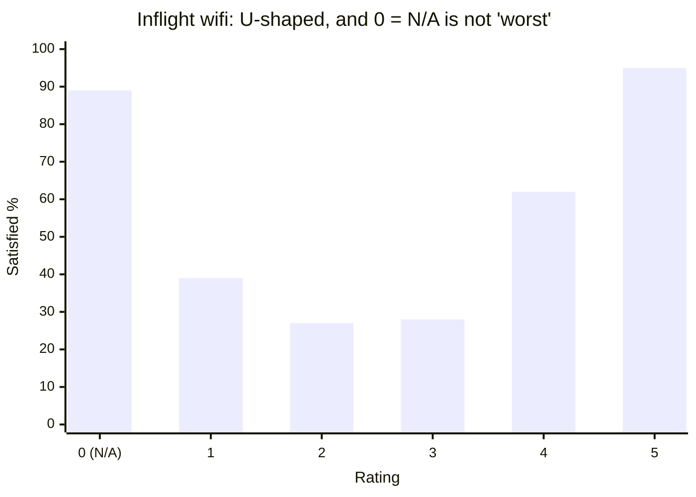

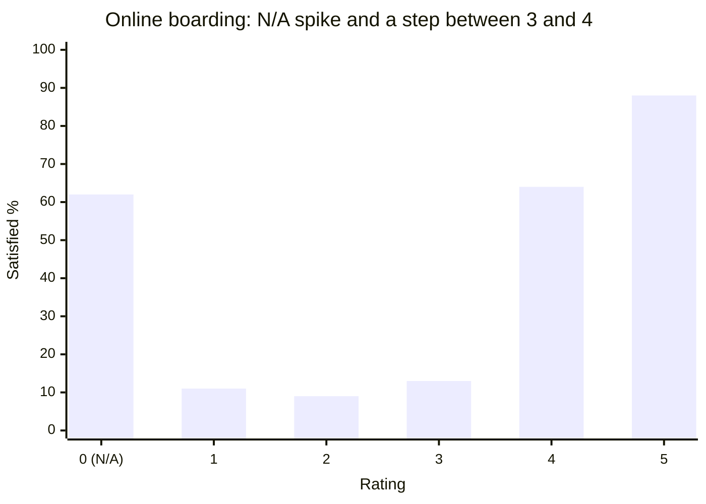

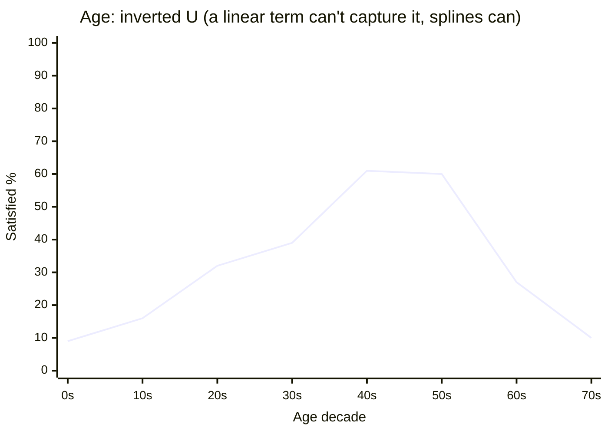

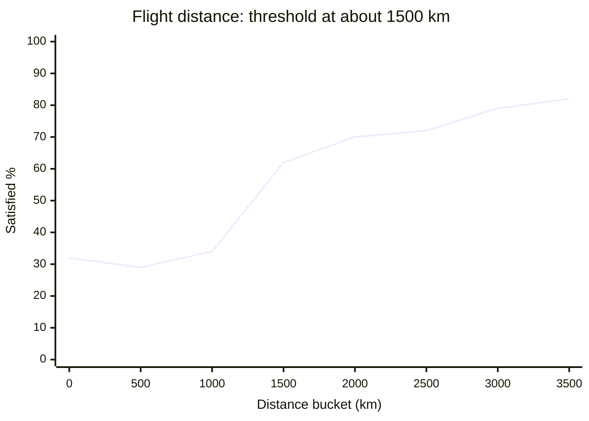

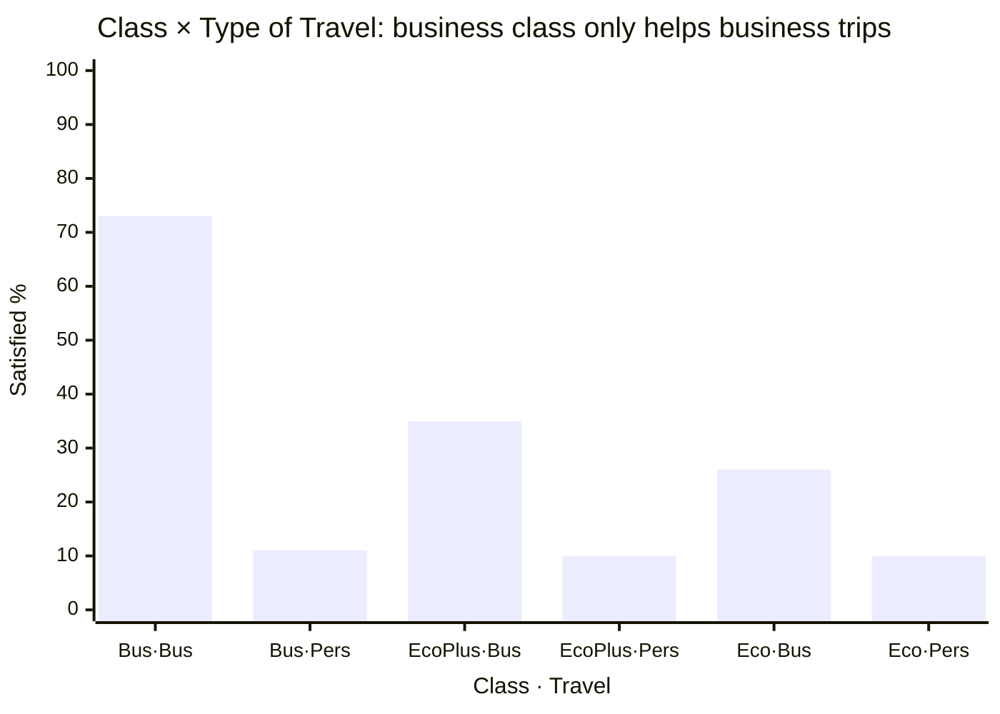

These observations become concrete experiments in §9.

---

## 4. Architecture

### 4.1 Data flow

Edge labels are the function that performs each step. Rounded boxes are data; plain boxes
are objects.

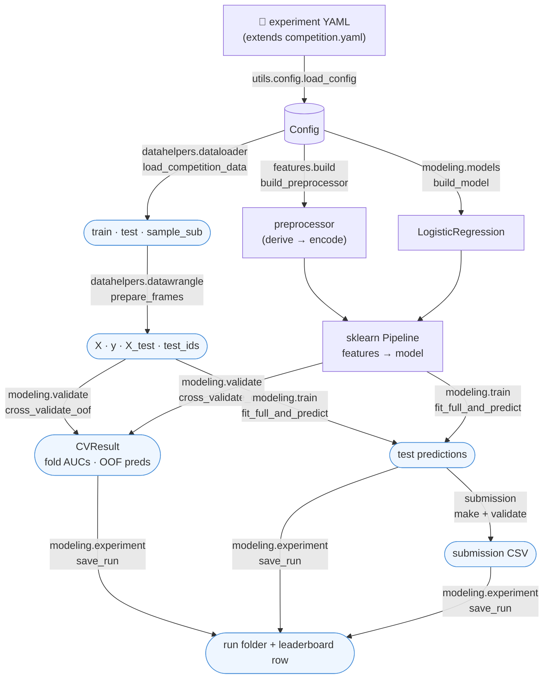

`modeling.experiment.run_experiment(cfg)` wires all of the above together. Both the CLI
and the notebook call it, or call the individual steps.

### 4.2 Directory layout

**Repo map** (what lives where):

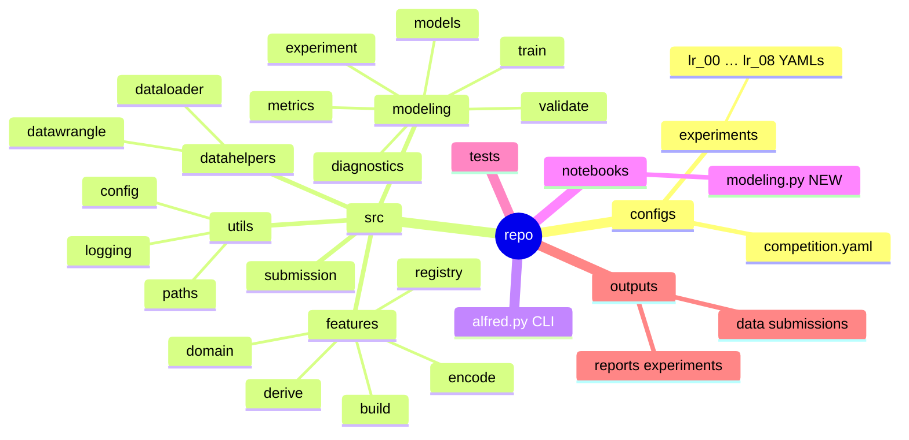

**Who imports whom.** Arrows point from caller to callee. Every arrow points down,
towards `utils`, so there are no circular imports. You can read the units bottom-up.

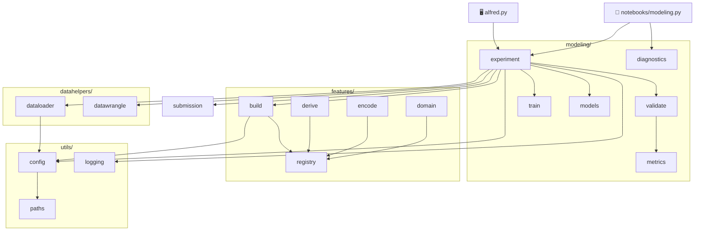

<details>
<summary>📂 Full file tree (new = ★, filled or extended = ✎)</summary>

```
alfred.py                         ✎ typer CLI entry point
pixi.toml                         ✎ [tasks] only (no dependency changes)
.gitignore                        ✎ ignore experiment parquet files and logs/
configs/
  competition.yaml                ★ competition-specific settings
  experiments/
    lr_00_baseline.yaml           ★ one YAML per experiment (ladder in §9)
    lr_01_ratings_onehot.yaml     ★ …
src/
  datahelpers/
    dataloader.py                 ✎ load raw files via DuckDB
    datawrangle.py                ✎ keep normalize_columns as is; add snake_case_columns, prepare_frames
  features/                       ★
    __init__.py
    registry.py                   decorator-based registry of feature blocks
    derive.py                     stateless, row-wise derived columns (generic)
    encode.py                     stateful, column-group encoders (impute/scale/onehot/spline/…)
    domain.py                     competition-specific derived columns (rating aggregates, etc.)
    build.py                      assemble config → sklearn Pipeline
  modeling/                       ★
    __init__.py
    models.py                     model registry ("logreg"; later "xgb", …)
    metrics.py                    metric registry ("roc_auc", "log_loss", "accuracy")
    validate.py                   CV + OOF
    train.py                      full fit + predict
    experiment.py                 orchestrate + persist artifacts + leaderboard
    diagnostics.py                pure functions returning DataFrames for plots (coefs, ROC, calibration)
  submission.py                   ★ build + validate submission
  utils/                          ★
    __init__.py
    config.py                     load/merge YAML, resolve paths, typed Config
    paths.py                      project-root discovery
    logging.py                    configure from configs/log_config.yaml
notebooks/
  modeling.py                     ★ fresh marimo notebook (storytelling)
tests/                            ★
  conftest.py                     synthetic DataFrame fixtures
  test_config.py
  test_features.py
  test_validate.py
  test_submission.py
reports/experiments/              ★ (created at runtime)
  <run_id>/…
  leaderboard.csv
data/submissions/                 ★ (created at runtime; *.csv gitignored)
```

</details>

---

## 5. Configuration spec

**How configs inherit.** Each experiment `extends` its parent and changes only what's new.
The fully merged result is saved with every run.

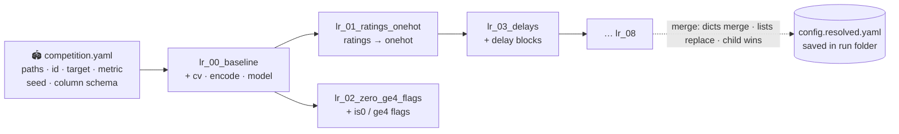

### 5.1 `configs/competition.yaml` (rewrite this per competition)

```yaml
competition: playground-series-s6e10      # kaggle slug, also used by `alfred submit`
data_dir: data/raw/playground-series-s6e10 # relative to project root
files:
  train: train.csv
  test: test.csv
  sample_submission: sample_submission.csv
id_col: id
target: satisfaction
task: binary                               # binary | (later) multiclass | regression
metric: roc_auc                            # key in modeling.metrics registry
seed: 42
column_names: snake_case                   # none | normalize (existing fn) | snake_case
schema:                                    # column roles, AFTER renaming
  continuous: [age, flight_distance, departure_delay_in_minutes, arrival_delay_in_minutes]
  ordinal:
    - inflight_wifi_service
    - departure_arrival_time_convenient
    - ease_of_online_booking
    - gate_location
    - food_and_drink
    - online_boarding
    - seat_comfort
    - inflight_entertainment
    - on_board_service
    - leg_room_service
    - baggage_handling
    - checkin_service
    - cleanliness
  categorical: [gender, customer_type, type_of_travel, class]
paths:
  experiments_dir: reports/experiments
  submissions_dir: data/submissions
```

### 5.2 `configs/experiments/<name>.yaml` (one file per experiment)

```yaml
name: lr_04_splines
description: "Add splines on age & flight distance to capture inverted-U / threshold"
extends: ../competition.yaml               # relative to this file
cv:
  n_splits: 5
  shuffle: true
  sample_frac: null                        # e.g. 0.2 for fast dev loops; null = full data

derive:                                    # stateless, row-wise; order matters; adds columns
  - missing_flag:   {cols: [arrival_delay_in_minutes]}
  - zero_flag:      {cols: "@ordinal"}     # "@group" = expand from schema
  - delay_features: {}                     # domain block: delay_diff, is_delayed
encode:                                    # stateful, per column group → ColumnTransformer
  - name: continuous
    cols: "@continuous"
    steps:
      - impute: {strategy: median}
      - log1p:  {cols: [departure_delay_in_minutes, arrival_delay_in_minutes]}
      - spline: {cols: [age, flight_distance], n_knots: 6, degree: 3}
      - scale:  {method: standard}
  - name: ratings
    cols: "@ordinal"
    steps:
      - scale: {method: standard}
  - name: categorical
    cols: "@categorical"
    steps:
      - onehot: {drop: if_binary}
  - name: flags
    cols: "@derived_flags"                 # columns produced by derive blocks tagged "flag"
    steps: [passthrough]
remainder: drop                            # anything not encoded is dropped (explicit > implicit)

model:
  name: logreg
  params: {C: 1.0, penalty: l2, solver: lbfgs, max_iter: 3000}
```

### 5.3 Rules for loading and merging configs (`utils/config.py`)

- `load_config(path) -> Config`. It reads the experiment YAML and recursively loads
  `extends`, then deep-merges, with the experiment winning. Dicts merge; lists replace.
- `"@group"` references expand from `schema`. `@derived_flags` and `@derived_numeric`
  expand from columns that `derive` blocks declare.
- All paths resolve against the project root (`utils.paths.project_root()`), which uses
  `$DIR_PROJECT` if set and otherwise searches upward for `pixi.toml`.
- `Config` is a frozen dataclass. Validation is light (required keys, known block names,
  known model and metric) and fails fast with a clear message.
- `config_hash(cfg) -> str` is a short hash of the resolved config, stored with each run
  so two identical configs are recognizable.

---

## 6. Module specs

Signatures are indicative. All public functions get type annotations and docstrings.

### 6.1 `src/utils/`
| Function | Purpose |
|---|---|
| `paths.project_root() -> Path` | `$DIR_PROJECT` or the nearest parent containing `pixi.toml` |
| `config.load_config(path: Path) -> Config` | Load, merge, expand and validate |
| `config.config_hash(cfg: Config) -> str` | Stable short hash |
| `logging.get_logger(name="alfred") -> Logger` | `logging.config.dictConfig` from `configs/log_config.yaml`; makes sure `logs/` exists |

### 6.2 `src/datahelpers/`
| Function | Purpose |
|---|---|
| `dataloader.load_competition_data(cfg) -> CompetitionData` | DuckDB `read_csv_auto` for train, test and sample submission, returned as pandas. This is the I/O boundary. `CompetitionData` is a small dataclass with `train`, `test`, `sample_submission`. |
| `datawrangle.normalize_columns(df)` | **Unchanged.** Existing behavior is preserved for `eda.py`. |
| `datawrangle.snake_case_columns(df)` | New. Lowercases and turns any non-alphanumeric run into `_`, so `Departure/Arrival time convenient` becomes `departure_arrival_time_convenient`. The existing function would leave a `/` in that name. |
| `datawrangle.rename_columns(df, mode)` | Dispatches on `cfg.column_names` |
| `datawrangle.prepare_frames(data, cfg) -> Frames` | Pure. Renames, casts the target to int, splits `X, y, X_test, test_ids`, applies `sample_frac` (stratified, seeded) and asserts that train/test columns match. |

CLI: `alfred.py profile <cfg>` prints a DuckDB `SUMMARIZE`, null counts and target rate,
as a quick sanity check.

### 6.3 `src/features/`

**The feature pipeline in one picture.** Stage ① adds columns without learning anything.
Stage ② learns from data, so it's fit inside each CV fold.

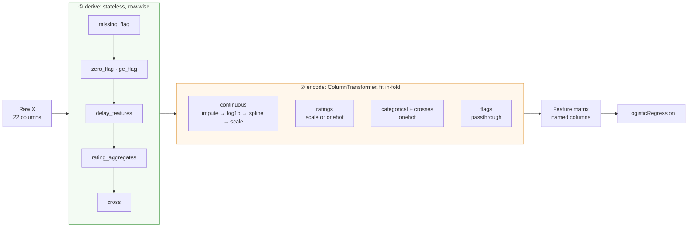

**Two kinds of feature blocks, kept separate on purpose:**
- **Derive blocks** are stateless and row-wise: `DataFrame -> DataFrame` with new
  columns added. Nothing is learned from data, so applying them before CV can't leak.
  They're wrapped in a `FunctionTransformer` inside the pipeline anyway, so the fitted
  pipeline accepts raw test data.
- **Encode steps** are stateful (they learn medians, scalers, spline knots or categories)
  and are always fit inside the CV fold. They're assembled into a `ColumnTransformer`,
  one sub-pipeline per column group.

`registry.py`
```python
@register_derive("zero_flag", tags=("flag",))
def zero_flag(df: pd.DataFrame, cols: list[str]) -> pd.DataFrame: ...

@register_encode("spline")
def spline(cols: list[str] | None = None, n_knots: int = 5, degree: int = 3) -> TransformerMixin: ...

get_derive(name) / get_encode(name) / list_blocks() -> DataFrame   # for the notebook catalogue
```

**Catalogue of blocks**

| Kind | Name | Module | Params | Output | Why it matters here |
|---|---|---|---|---|---|
| derive | `missing_flag` | derive | `cols` | `<col>__isna` (int8) | Arrival delay NaNs |
| derive | `zero_flag` | derive | `cols` | `<col>__is0` | A rating of 0 means N/A, with a very different target rate |
| derive | `ge_flag` | derive | `cols`, `threshold` | `<col>__ge{t}` | Ratings show a step between 3 and 4 |
| derive | `ratio` / `diff` | derive | `pairs` | `<a>__minus__<b>` | Generic arithmetic |
| derive | `cross` | derive | `pairs` (or triples) | `<a>__x__<b>` as a string category | Class × Type of Travel interaction |
| derive | `bins` | derive | `col`, `edges`, `labels` | `<col>__bin` category | An alternative to splines |
| derive | `delay_features` | domain | none | `delay_diff`, `is_delayed`, `total_delay` | Delays are skewed and weakly informative |
| derive | `rating_aggregates` | domain | `cols`, `groups` | `rating_mean`, `_min`, `_max`, `_std`, `n_zero`, `n_ge4`, and `grp_<name>_mean` per group | Overall-experience signal |
| encode | `impute` | encode | `strategy`, `cols?` | same columns | Median for delays |
| encode | `log1p` | encode | `cols?` | same columns | Skewed delays |
| encode | `clip` | encode | `lower_q`, `upper_q` | same columns | Outliers; quantiles are learned in-fold |
| encode | `spline` | encode | `cols?`, `n_knots`, `degree` | `<col>_sp{k}` | Inverted U in age, threshold in distance |
| encode | `scale` | encode | `method: standard\|robust\|minmax` | same columns | Needed for regularized LR |
| encode | `onehot` | encode | `drop`, `min_frequency`, `handle_unknown=ignore` | dummies | Categoricals, crosses, ratings-as-categories |
| encode | `passthrough` | encode | none | same columns | Flags |

The rating groups for `rating_aggregates` are set in config, not code:
`digital: [inflight_wifi_service, ease_of_online_booking, online_boarding]`,
`comfort: [seat_comfort, inflight_entertainment, leg_room_service, cleanliness]`,
`service: [on_board_service, checkin_service, baggage_handling, food_and_drink]`,
`airport: [gate_location, departure_arrival_time_convenient]`.
Aggregates **exclude zeros**, since 0 means N/A.

`build.py`
```python
def build_preprocessor(cfg: Config) -> Pipeline:
    """Pipeline([("derive", FunctionTransformer(apply_derive_blocks)),
                 ("encode", ColumnTransformer([...], remainder=cfg.remainder))])
       .set_output(transform="pandas")  # keeps readable feature names end-to-end"""

def feature_names(fitted_pre: Pipeline) -> list[str]
```
`set_output(transform="pandas")` makes coefficient tables readable. If it turns out to be
too slow or memory-heavy with many one-hot columns, the fallback is sparse output plus
`get_feature_names_out()`.

### 6.4 `src/modeling/`

**How one experiment runs, and where leakage is prevented:**

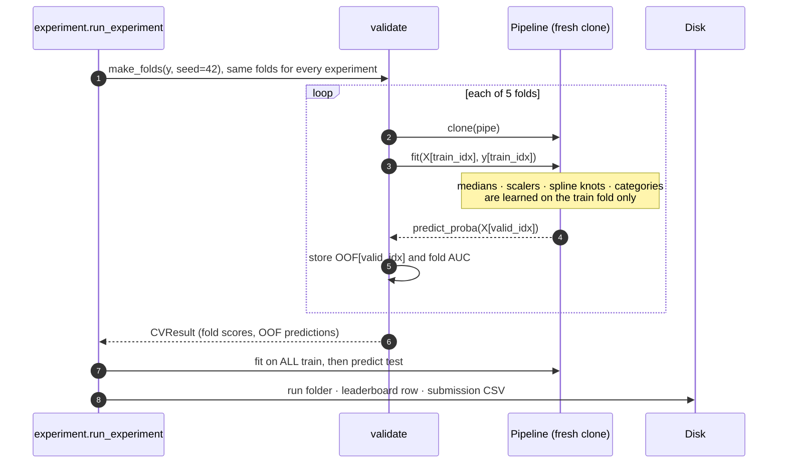
| Function / object | Purpose |
|---|---|
| `models.build_model(model_cfg, seed) -> ClassifierMixin` | Registry: `"logreg"` maps to `LogisticRegression(**params, random_state=seed)`. Later models are added with one decorator each. |
| `metrics.get_metric(name) -> Callable[[y, p], float]` | `roc_auc`, `log_loss`, `accuracy@0.5`. The primary metric comes from config, and the others are logged too. |
| `validate.make_folds(y, cv_cfg, seed) -> list[tuple[idx, idx]]` | `StratifiedKFold`, saved per run. **Same seed means same folds for every experiment.** |
| `validate.cross_validate_oof(pipe, X, y, folds, metrics) -> CVResult` | Clones the pipeline per fold and fits on the train fold. Returns `fold_scores` (DataFrame of fold × metric), `oof` (array), `fit_seconds`, `fold_pipelines` (optional). |
| `train.fit_full_and_predict(pipe, X, y, X_test) -> tuple[Pipeline, ndarray]` | Refits on all training data and predicts probabilities for test |
| `experiment.run_experiment(cfg, *, save=True, predict_test=True) -> RunResult` | Orchestrates everything and persists the artifacts in §7 |
| `diagnostics.coefficients(fitted_pipe) -> DataFrame` | Feature name, coefficient, absolute value, sign |
| `diagnostics.roc_points(y, p)`, `calibration_table(y, p, n_bins)` | DataFrames for Plotly |
| `diagnostics.score_by_segment(y, p, segment) -> DataFrame` | AUC per Class/Travel segment, to find where the model is weak |
| `diagnostics.leaderboard(experiments_dir) -> DataFrame` | Reads `leaderboard.csv` (with DuckDB) |

### 6.5 `src/submission.py`
| Function | Purpose |
|---|---|
| `make_submission(test_ids, preds, sample_sub, id_col, target) -> DataFrame` | Aligns to the `sample_sub` id order |
| `validate_submission(sub, sample_sub) -> None` | Raises if the row count is wrong, the id set or order differs, there are NaNs or infs, values fall outside [0, 1] for a binary task, or column names are wrong |
| `write_submission(sub, path) -> Path` | I/O |

### 6.6 `alfred.py` (typer CLI)

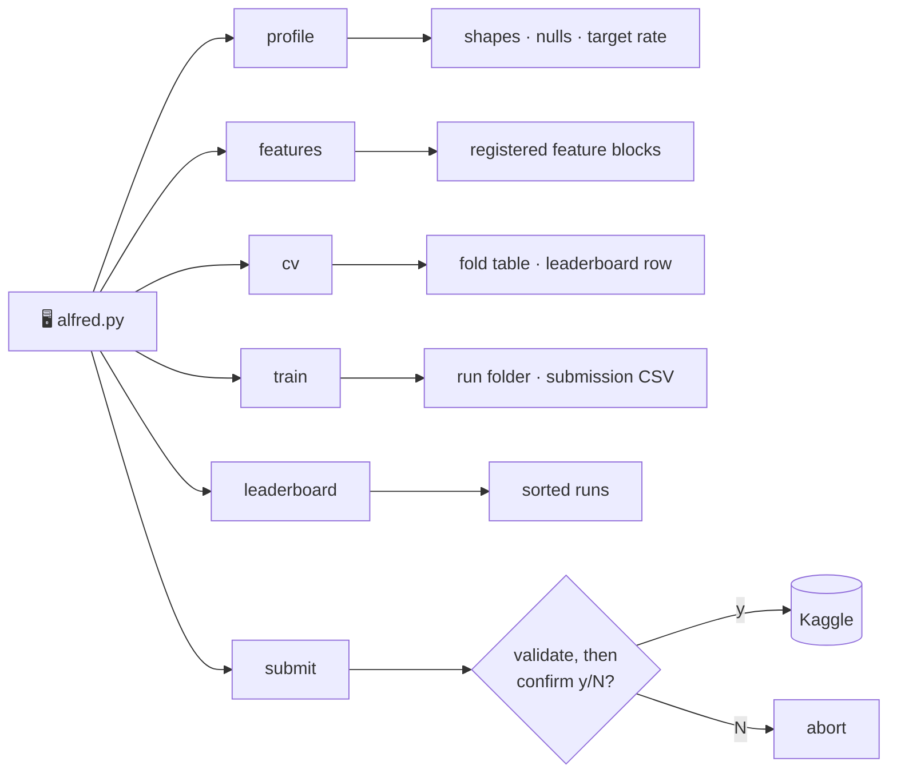

| Command | Behavior |
|---|---|
| `alfred.py profile CONFIG` | Quick data profile via DuckDB |
| `alfred.py features` | Lists the registered feature blocks |
| `alfred.py cv CONFIG [--sample-frac 0.2]` | CV only. Prints fold table and OOF AUC, appends to leaderboard, no test prediction. |
| `alfred.py train CONFIG` | CV, then full fit, then a submission CSV, with all artifacts saved |
| `alfred.py leaderboard [--top 20]` | Prints the sorted leaderboard |
| `alfred.py submit SUBMISSION_CSV -m MSG` | Validates the file, prints a summary, **asks for explicit y/N confirmation**, then runs `kaggle competitions submit`. A `--yes` flag skips the prompt, but only for your own use. |

Matching `pixi.toml` tasks:
```toml
[tasks]
sync-agents = "python scripts/sync_agent_config.py"   # existing
test        = "pytest -q"
cv          = "python alfred.py cv"
train       = "python alfred.py train"
leaderboard = "python alfred.py leaderboard"
```
Usage: `pixi run cv configs/experiments/lr_01_ratings_onehot.yaml`.

---

## 7. Run artifacts and leaderboard

**`run_id`** is `YYYYMMDD-HHMMSS_<experiment name>`.

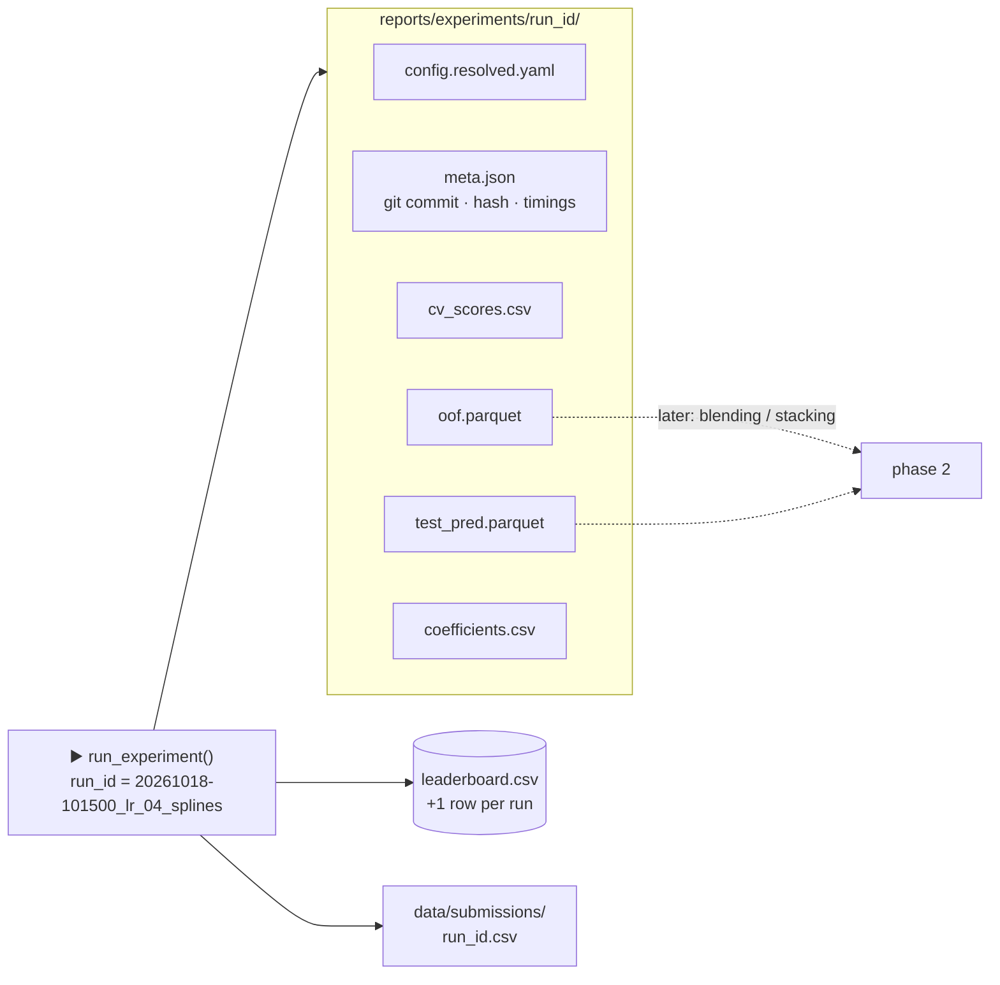

```
reports/experiments/<run_id>/
  config.resolved.yaml     # fully merged config (reproduce with `alfred train` on this file)
  meta.json                # run_id, git commit + dirty flag, config_hash, seed, n_rows, n_features, timings, sklearn version
  cv_scores.csv            # fold × metric (gitignored *.csv — fine, also summarized in meta.json)
  oof.parquet              # id, y, oof_pred  (gitignored)
  test_pred.parquet        # id, pred         (gitignored)
  coefficients.csv         # LR only
data/submissions/<run_id>.csv
```

**`reports/experiments/leaderboard.csv`** gets one row appended per run:
`run_id, name, description, model, n_features, cv_mean, cv_std, oof_auc, oof_logloss, fit_seconds, config_hash, git_commit, submission_path, public_lb`.
You fill in `public_lb` by hand after you submit.

Note that `*.csv` is gitignored, so the leaderboard stays local. If you'd like it
versioned, I'll add a `!reports/experiments/leaderboard.csv` exception. Your call.

---

## 8. Fresh notebook: `notebooks/modeling.py`

Its purpose is a **storytelling, slide/app-friendly** walkthrough that you can set side by
side with `notebooks/eda.py`. Cells stay short and call into `src/`. Each section opens with
a markdown cell that explains *what* and *why*, including metric definitions and
assumptions.

**Storyboard.** One slide per box, grouped into four acts:

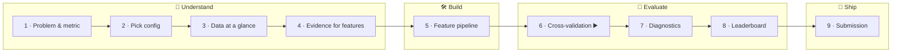

▶️ means the slide is behind a run button, because it's expensive.

| # | Section (slide) | Content |
|---|---|---|
| 1 | Problem & metric | Competition summary, ROC AUC definition, submission format |
| 2 | Config | `mo.ui.dropdown` over `configs/experiments/*.yaml`, plus the resolved config shown as a tree |
| 3 | Data at a glance | `load_competition_data` → shapes, target rate, nulls (DuckDB summary table) |
| 4 | Evidence for features | Plotly target-rate charts for the §3 observations (wifi U-shape, age inverted-U, distance threshold, Class × Travel heatmap) |
| 5 | Feature pipeline | Registered block catalogue, the pipeline diagram (`mo.Html(pipeline._repr_html_())`), and the list of output feature names |
| 6 | Cross-validation | Run button (`mo.ui.run_button`) so CV doesn't re-run on every change; fold table and OOF AUC |
| 7 | Diagnostics | ROC curve, calibration curve, top ± coefficients, AUC by segment |
| 8 | Leaderboard | All runs compared (bar chart of OOF AUC ± std) |
| 9 | Submission | Validation summary, file path; upload stays a manual CLI step |

Setup cell conventions copied from `eda.py`: `load_dotenv()`, the DuckDB connection,
`plotly` as the pandas plotting backend, and project-root on `sys.path`.

The expensive cells (CV, full fit) sit behind `mo.ui.run_button` and use
`mo.stop`/`mo.persistent_cache`, per the marimo `EXPENSIVE.md` guidance.

---

## 9. Feature-engineering experiment ladder

**Protocol**
- Every rung uses the same 5 folds (seed 42).
- A rung is **kept** if OOF AUC improves by **≥ 0.0005** and that gain is larger than
  the fold standard deviation. Otherwise it's reverted.
- Early rungs may use `sample_frac: 0.25` for speed, and the winner is confirmed on full
  data.
- Each rung is one YAML file that `extends` the previous winner.

**The keep/revert rule** applied at every rung:

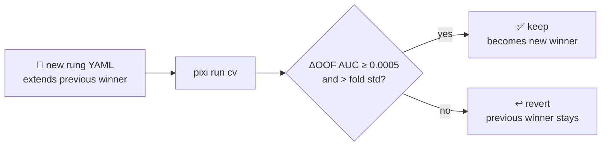

**The ladder.** Rungs 01 and 02 are competing alternatives; everything after builds on
the winner.

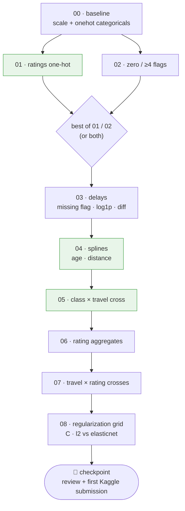

🟩 Green rungs are the ones where the EDA in §3 predicts the biggest gains.

| Rung | Experiment | Change vs previous | Hypothesis (from §3) |
|---|---|---|---|
| 00 | `lr_00_baseline` | Median impute + standard scale continuous; ratings as scaled numerics; one-hot categoricals | Reference point |
| 01 | `lr_01_ratings_onehot` | Ratings → **one-hot** (0–5 categories) instead of linear | Captures the wifi U-shape, 0 = N/A, and the 3→4 step. Expected to be the biggest single gain. |
| 02 | `lr_02_zero_ge4_flags` | *Alternative to 01:* keep ratings linear, add `__is0` and `__ge4` flags | Fewer parameters than one-hot. Keep whichever of 01/02 wins, or both if they combine well. |
| 03 | `lr_03_delays` | `missing_flag`, `log1p` on delays, `delay_features` | Small gain expected from fixing skew |
| 04 | `lr_04_splines` | Splines on age and flight distance | Inverted U in age and threshold at 1500 for distance; expected to be a sizeable gain |
| 05 | `lr_05_class_travel_cross` | `cross: [[class, type_of_travel], [class, customer_type]]` → one-hot | Business class only helps business travellers |
| 06 | `lr_06_rating_aggregates` | `rating_aggregates` with N/A-aware means and group means | Overall-experience signal, which helps LR combine many weak ratings |
| 07 | `lr_07_rating_crosses` | Crosses of type_of_travel × {wifi, online_boarding} (one-hot) | Rating effects may differ by trip purpose |
| 08 | `lr_08_regularization` | Small grid: `C ∈ {0.01, 0.1, 1, 10}`, `penalty ∈ {l2, elasticnet (saga, l1_ratio 0.5)}` | Tuning matters once the feature count grows |

After rung 08 there's a natural checkpoint. We look at the leaderboard and diagnostics
together, make the first Kaggle submission (manually confirmed), and then decide on
phase 2 (§13).

Optional blocks are registered but **not** on the ladder: `bins` (alternative to splines)
and distance digit/modulo features (synthetic-data artefacts that tree models usually
exploit). They're available for later.

---

## 10. Tests (`pixi run test`)

All tests use a small **synthetic** DataFrame (about 200 rows) built in `conftest.py` with
the same schema. No private data is touched.

| File | Tests |
|---|---|
| `test_config.py` | `extends` merge (dicts merge, lists replace); `@group` expansion; unknown block or model raises; paths resolve relative to the root |
| `test_features.py` | Each derive block adds exactly the declared columns and never reads the target. `build_preprocessor` gives identical output columns on train and test. Unseen categories in test don't crash (`handle_unknown=ignore`). `snake_case_columns` handles `/`. `normalize_columns` behavior is unchanged. |
| `test_validate.py` | **Leakage guard:** the scaler's mean equals the train-fold mean, not the full-data mean. The same seed gives identical folds and scores. OOF covers every row exactly once. |
| `test_submission.py` | Rejects wrong row counts, NaNs, out-of-range values and mismatched ids; accepts a valid file; preserves `sample_sub` order |

---

## 11. Implementation milestones

Each milestone ends with a check that has actually been run.

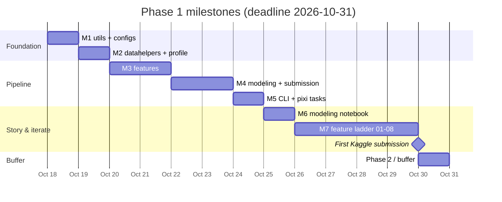

The dates are indicative, assuming roughly one pairing session a day. Adjust to your pace.

| M | Deliverable | Acceptance check |
|---|---|---|
| M1 | `utils/` (paths, config, logging), `configs/competition.yaml`, `lr_00_baseline.yaml` | `test_config.py` passes; `load_config` prints the resolved config |
| M2 | `datahelpers` (loader, `snake_case_columns`, `prepare_frames`), `alfred.py profile` | `pixi run python alfred.py profile …` matches the counts in §3 |
| M3 | `features/` (registry, derive, encode, domain, build), `alfred.py features` | `test_features.py` passes; on real data the preprocessor output has no NaNs and deterministic columns |
| M4 | `modeling/` (models, metrics, validate, train, experiment, diagnostics), `submission.py` | `test_validate.py` and `test_submission.py` pass |
| M5 | CLI `cv`/`train`/`leaderboard`, pixi tasks, `.gitignore` additions | `pixi run train configs/experiments/lr_00_baseline.yaml` produces a run folder, a leaderboard row and a validated submission. Runtime is reported. |
| M6 | `notebooks/modeling.py` | Notebook runs top to bottom (`marimo export` / headless run) with no errors; reviewed with you live |
| M7 | Ladder rungs 01–08 (YAML only) | Leaderboard comparison reviewed together; first submission is uploaded **only after your go-ahead** |

---

## 12. Performance and risks

| Risk | Mitigation |
|---|---|
| 700k rows × hundreds of one-hot or spline columns could make LR slow or memory-heavy with pandas output | `sample_frac` for dev loops; float32 casting; fall back to sparse output plus `solver="saga"`; record `fit_seconds` in the leaderboard |
| Convergence warnings from `lbfgs` | Scaling is always on; `max_iter` is configurable; warnings are surfaced in the run log |
| Overfitting CV by climbing many rungs | Fixed folds, a minimum-gain threshold and a public-LB sanity check at the checkpoint |
| Feature-name explosion makes coefficients unreadable | Consistent `__` naming convention; coefficient table is grouped by source column in diagnostics |
| Config typos fail silently | Fail-fast validation of block names, params and column references |

---

## 13. Extension points for later phases

- **New model:** add one `@register_model("xgb")` function, then set `model.name: xgb`
  in YAML. Tree models get an `encode` profile without scaling or splines.
- **Target or frequency encoding:** add a new `encode` step. It's fit in-fold
  automatically because it lives in the `ColumnTransformer`.
- **Blending or stacking:** every run already saves `oof.parquet` and
  `test_pred.parquet` with ids, so a `modeling/ensemble.py` can read them back.
- **Hyperparameter search:** `run_experiment` takes a config, so a grid or Optuna loop
  only needs to generate configs.
- **New competition:** clone the repo, rewrite `configs/competition.yaml`, add or replace
  blocks in `features/domain.py`, and write new experiment YAMLs.

---

## 14. Known pre-existing issues (left alone, per D4)

- `notebooks/eda.py`: the sweetviz cell is unparsable because the line `analyze: training
  columns vs TARGET` is missing a leading `#`.
- `notebooks/eda.py` builds paths as `f"{DIR_KAGGLE}train.csv"`, which needs a trailing
  slash in `.env`. The new loader uses `pathlib` and doesn't depend on it.

---

## 15. Open items to confirm before building

1. **Leaderboard in git:** add a `!reports/experiments/leaderboard.csv` exception so run
   history is versioned? I'd say yes; it's small and has no private data.
2. **Column naming:** the new pipeline uses `snake_case_columns`, so names like
   `departure_arrival_time_convenient` differ slightly from `eda.py`'s
   `departure/arrival_time_convenient`. Is that OK?
3. **Fast-loop default:** use `sample_frac: 0.25` for rungs 01–07 and confirm the winners
   on full data? Or run everything on full data, which is slower per run but simpler?
