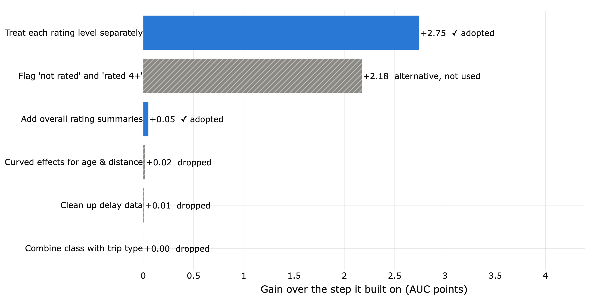
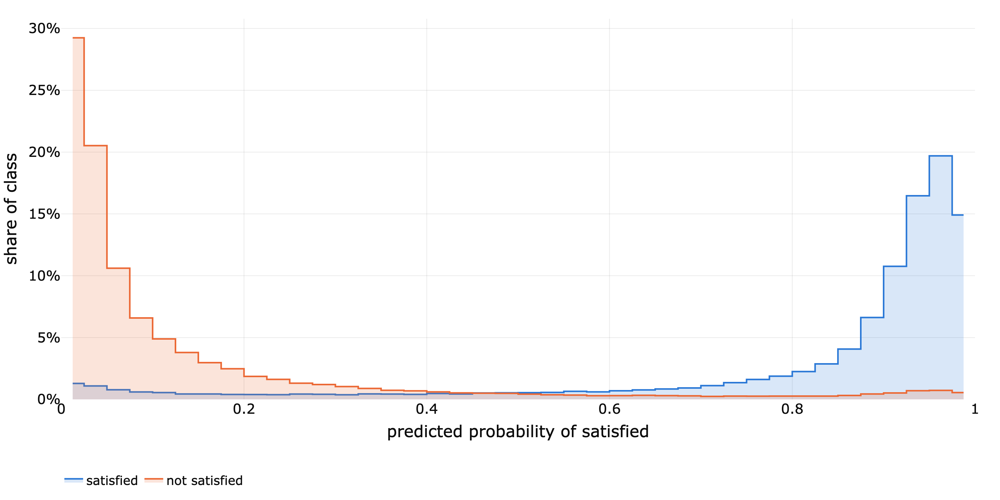
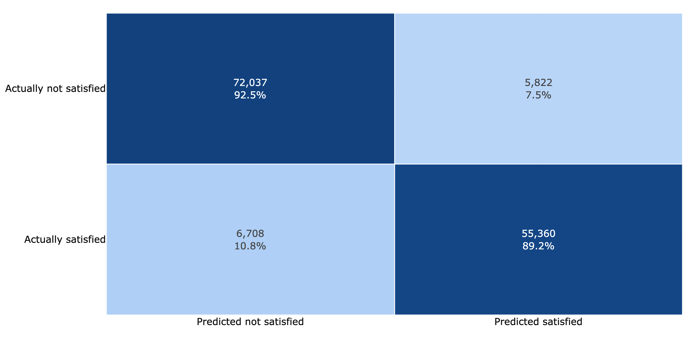
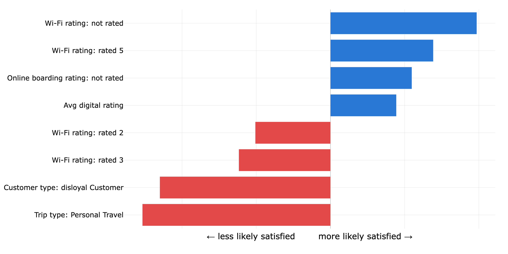
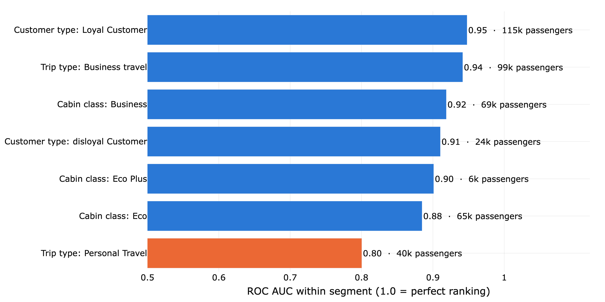
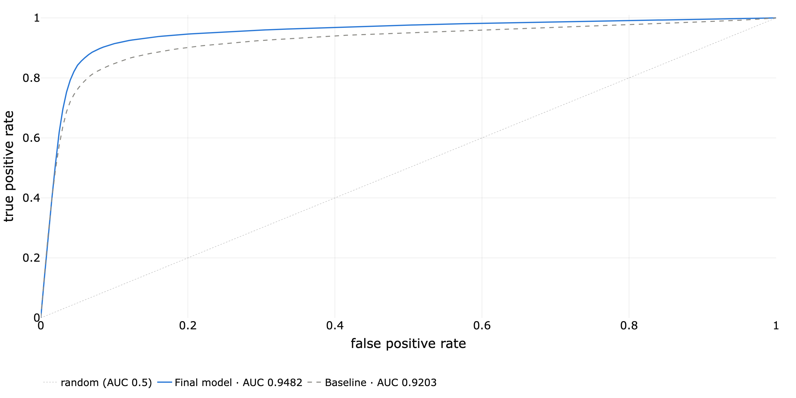
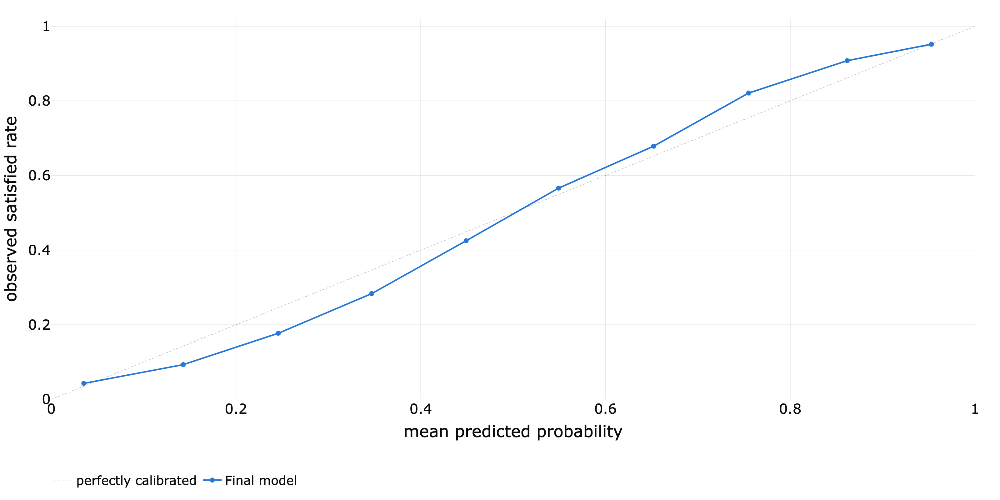

footer: Airline satisfaction · Phase 2
slidenumbers: true
autoscale: true

[.hide-footer]

[.slidenumbers: false]

# Predicting Airline Passenger Satisfaction

### Phase 2 · What drives the prediction

October 2026

^ This deck summarizes the feature-engineering phase: which ideas improved the prediction, how good the model is today, and where it still struggles.

---

## The bottom line

- The model ranks a satisfied passenger above an unsatisfied one **95 times in 100** (up from 92 with a basic setup)
- It labels **91%** of passengers correctly
- One idea did most of the work: **treat each rating level separately**
- Weak spot: **Personal Travel (trip type)** passengers (ranking score 0.80), the next focus

^ Score: ROC AUC 0.9482 vs 0.9203 for the baseline, measured on passengers the model did not see during training.

^ 6 feature ideas were tested; 2 are in the final model.

---

## What we predict, and how we keep score

[.column]

**The question**

Will a passenger report being *satisfied*?

699,635 past passengers · 21 inputs: 13 service ratings (0-5), trip details, delays and passenger profile

[.column]

**The score: ROC AUC**

Pick one satisfied and one unsatisfied passenger at random. AUC is how often the model ranks the satisfied one higher.

0.5 = coin flip · 1.0 = perfect

[.column]

**Fair testing**

20% of passengers are locked away for a final check.

Ideas are compared on a 140k sample, scored 4 times on passengers each model never saw.

^ All comparisons use the same passengers and the same test splits, so differences between ideas are real, not luck of the draw.

^ The model is deliberately simple (logistic regression) in this phase, so every gain comes from how the data is presented to it.

---

## One idea drove almost all of the gain

**Treat each rating level separately**

^ Biggest gain: +2.75 AUC points. Ratings behave in steps, not straight lines: a Wi-Fi rating of 0 means 'not rated', and those passengers are mostly satisfied. A rating of 3 is much closer to 1 than to 5.

^ In the final model: Treat each rating level separately, Add overall rating summaries.

^ An idea is adopted only if it adds at least 0.05 AUC points, and more than its normal variation across the test splits. Everything else is dropped to keep the model simple.

---

## Most passengers get a confident, correct score

^ Each curve shows where passengers' predicted probability of satisfaction falls. Satisfied passengers (blue) cluster near 1, unsatisfied (orange) near 0.

^ The overlap in the middle is where the model is unsure, and where its mistakes are.

---

## 91% of passengers are labeled correctly

^ 11% of satisfied passengers are labeled unsatisfied, and 7% of unsatisfied passengers are labeled satisfied (at a 50% cut-off).

^ The cut-off can be moved to favor catching unhappy passengers, at the cost of more false alarms.

---

## Trip type, customer type and Wi-Fi rating carry the strongest signals

^ Blue pushes towards 'satisfied', red away from it. Personal (leisure) trips and disloyal customers lean unsatisfied; a top Wi-Fi rating leans satisfied.

^ These are associations in the data, not causes, and each one is measured with all the others held fixed.

---

## Weakest on Personal Travel (trip type) passengers

^ Ranking quality for Personal Travel (trip type) passengers is 0.80, against 0.95 for the strongest segment. Only 10% of them are satisfied, so the few happy ones are hard to pick out.

^ The next idea tested targets this group directly: letting ratings matter differently by trip type.

---

## Next steps

- Target the weak spot: let rating effects differ for personal travel passengers
- Tune how strongly the model is constrained
- Confirm on all data, then once on the locked-away 20%
- Submit the first competition entry

^ Each step changes one thing at a time, so we always know what helped.

---

[.hide-footer]

# Appendix

---

## Model vs baseline: ranking quality

^ A curve closer to the top-left corner ranks better. The area under it is the AUC.

---

## Predicted probabilities are close to reality (within 7 points)

^ Points on the dotted diagonal would be perfect. The largest gap across well-populated bins is 6.9 percentage points: mid-range scores are slightly too cautious, which matters little for ranking but could be corrected if probabilities are used directly.

---

## All ideas tested

| Idea | AUC | Change (pts) | Decision |
|:---|---:|---:|:---|
| Baseline: all inputs as-is | 0.9203 |  | starting point |
| Treat each rating level separately | 0.9477 | +2.75 | adopted |
| Flag 'not rated' and 'rated 4+' | 0.9420 | +2.18 | alternative, not used |
| Clean up delay data | 0.9478 | +0.01 | dropped |
| Curved effects for age & distance | 0.9479 | +0.02 | dropped |
| Combine class with trip type | 0.9477 | +0.00 | dropped |
| Add overall rating summaries | 0.9483 | +0.05 | adopted |

^ AUC is the average over 4 test splits on the 140k sample. Change is measured against the step each idea built on. 'Alternative, not used' beat the baseline but lost to a better idea for the same job.
